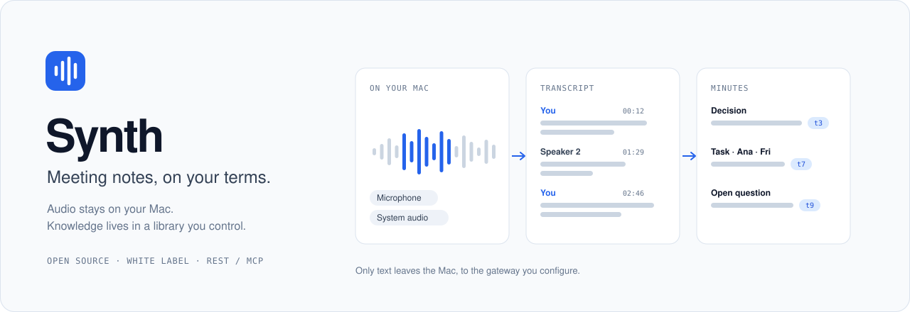
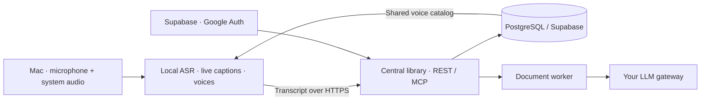

<div align="center">

<picture>
  <source media="(prefers-color-scheme: dark)" srcset="docs/assets/synth-banner-dark.svg" />
  
</picture>

### An open source meeting notebook. A central library you control.

<a href="LICENSE.md"></a>
<a href="https://github.com/AlexHHPS/synth/actions/workflows/synth-checks.yml"></a>
<a href="docs/synth/installation.md"></a>

**[Get started](docs/synth/installation.md)** &nbsp;·&nbsp;
[Architecture](docs/synth/architecture.md) &nbsp;·&nbsp;
[Minutes & glossary](docs/synth/minutes-glossary-questions.md) &nbsp;·&nbsp;
[API & MCP](docs/synth/integrations.md) &nbsp;·&nbsp;
[Make it yours](docs/synth/white-label.md) &nbsp;·&nbsp;
[Security](docs/synth/security.md)

</div>

<br />

Capture a quick thought, an in-person conversation or a remote call. Synth turns
it into a transcript in speaker turns and minutes where every point cites its
source, then keeps them in a library your team and your other systems can use.

**The audio stays on your Mac. Your central library holds the knowledge.**

> [!NOTE]
> **New in 0.5** — readable minutes with tracked follow-ups, a glossary that
> learns, questions to your meetings, an optional Google Calendar agenda, local
> live captions and per-actor row level security.

## What you get

<table>
<tr>
<td width="33%" valign="top">

#### 🎙️&nbsp; Capture on the Mac

- Microphone and system audio, **no meeting bot**.
- Live captions and live voice identification, each in its own widget.
- A floating reminder when a call starts; optional Calendar agenda.
- A single speaker is a valid note.

</td>
<td width="33%" valign="top">

#### 🧾&nbsp; Understand with sources

- Minutes by topic: decisions, tasks, open questions, **each cited**.
- Owners only when someone committed; dates only when said.
- Follow-ups from earlier meetings in the folder are tracked.
- A glossary that learns names and fixes misspellings — the raw transcript is never rewritten.

</td>
<td width="33%" valign="top">

#### 🔗&nbsp; Share under control

- Private by default; folders shared explicitly.
- Ask your meetings: answers only from what **you** can read.
- REST and MCP with folder-scoped, read-only integration keys.
- PostgreSQL enforces per-actor access, not only the API.

</td>
</tr>
</table>

<details>
<summary><b>And the details that make it dependable</b></summary>
<br />

- **Voices have context.** Enroll locally and choose whether to share an encrypted voice centroid. Matching runs on the Mac and only proposes candidates; confirmed speakers carry across the meeting.
- **Every result has a source.** Document references point to the transcript version used to generate them.
- **Work survives interruptions.** Checkpoints, retries, resumable drafts and version fences keep older jobs from replacing newer results.
- **One library for the team.** Employees sign in through your Supabase Google Auth configuration.
- **Your product, your identity.** Name, mark, accent, bundle identifier, links and approved backend are configured before building.

</details>

## Where your data lives



| 💻 On the Mac | ☁️ In your central deployment |
| :--- | :--- |
| Capture, live ASR, diarization, enrollment and voice comparison. | Library text, versions, permissions, glossary, minutes and encrypted shared centroids. |
| Temporary audio, deleted after analysis; interrupted audio expires within 24 hours while the host runs. | HTTPS API/MCP and your document worker. No recording upload endpoint. |
| Local voice profiles encrypted with a Keychain-protected key. | Shared centroids encrypted with a server key kept outside the database. |

> [!IMPORTANT]
> Only text goes to the LLM gateway you configure, and that gateway may use
> external providers: Synth does not claim that minutes are generated locally.
> Shared profiles are available to authorized employee clients for comparison;
> this is controlled organizational sharing, not end-to-end encryption against
> the server operator.

[Explore the architecture →](docs/synth/architecture.md)

## Get started

The complete pipeline targets **Apple Silicon, macOS 14.2+ and Spanish**. Deploy
one instance per organization, with your own Supabase project for Google Auth and
PostgreSQL and a container host for the API and document worker.

```sh
git clone https://github.com/AlexHHPS/synth.git
cd synth
git submodule update --init --recursive
```

Then follow the [installation guide](docs/synth/installation.md) to prepare the
pinned models, source-built FFmpeg, native app and portable host. Packaged users
do not need Python, Rust or Xcode; the live speech runtime installs itself during
first-run setup.

> [!WARNING]
> **Release status:** source and build tooling are available. A published
> installer, Developer ID signature and notarization are not yet provided.
> Windows/Linux code is inherited but the Synth pipeline is not validated there.
> See the [readiness checklist](docs/synth/readiness.md).

## Make it yours

```sh
python3 scripts/configure-brand.py \
  --name "Example Voice" --identifier dev.example.voice \
  --accent "160 70% 35%" --logo /example-mark.svg --generate-icons \
  --api-url https://voice.example.com \
  --supabase-url https://exampleproject.supabase.co \
  --source-url https://example.com/source \
  --documentation-url https://example.com/docs \
  --support-url https://example.com/support
```

One command updates the UI name and accent, About, bundle metadata, native icons,
app-data namespaces and the approved backend. Rebuild the native client and the
packaged host together, and keep credentials in server secrets, never in
branding files. → [White label guide](docs/synth/white-label.md)

## Give other systems the context

Completed library entries are readable without the recording Mac online.

| | REST | MCP |
| :--- | :--- | :--- |
| **Endpoint** | `https://voice.example.com/v1` | `https://voice.example.com/mcp` |
| **Auth** | Bearer: employee session or scoped integration key | Streamable HTTP, same scopes |
| **Reads** | Transcripts, notes, minutes, versions, status, search | Library tools such as `get_transcript`, `get_document`, `search_transcripts`, `ask_meetings` |

Requests without valid credentials are denied. Integration keys cannot upload,
edit meetings or read the voice catalog. → [Client setup](docs/synth/integrations.md)

## Built with verification

Automated checks cover processing state, transcript recovery, citations, minutes
rules, glossary corrections, access control (including row level security against
a real PostgreSQL) and white label configuration. CI builds the frontend and the
service image and audits public source for private names, paths and credentials.

> [!CAUTION]
> Voice names remain **provisional until independently calibrated**. Synthetic
> tests verify the circuit, not human recognition accuracy. Test real enrollment
> and calls before relying on recognition — see
> [voice calibration](docs/synth/voice-calibration.md) and [security](docs/synth/security.md).

## Open source, with clear origins

Synth derives from **Meetily Community Edition**, created by Zackriya Solutions,
under the [original MIT license](LICENSE.md). It is an independent product with
its own branding and added implementation; it is not an official Meetily release
or a license to Meetily Pro. Dependencies and models keep their own terms,
including Apache 2.0, CC BY 4.0 and LGPL — see [third-party notices](NOTICE.md)
and the [Community and redistribution policy](docs/synth/community-policy.md).

<div align="center">
<br />

[Contribute](CONTRIBUTING.md) &nbsp;·&nbsp; [Report an issue](https://github.com/AlexHHPS/synth/issues)

</div>
